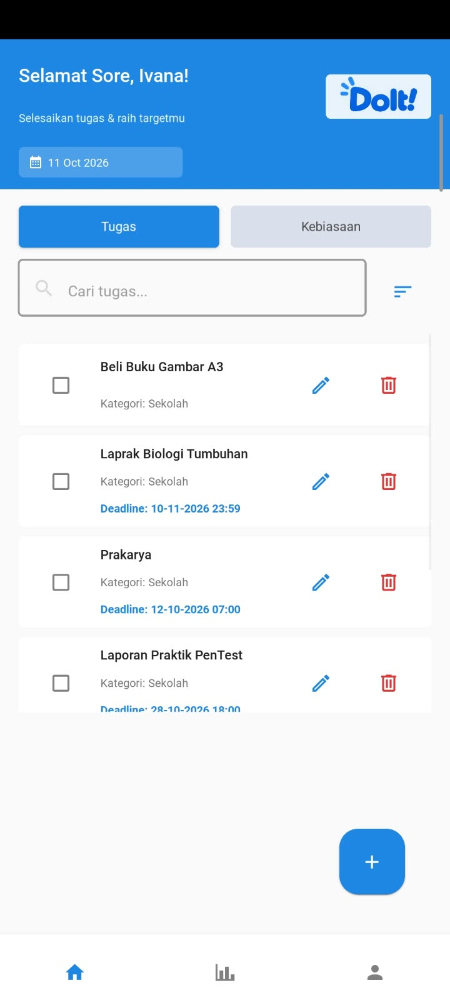
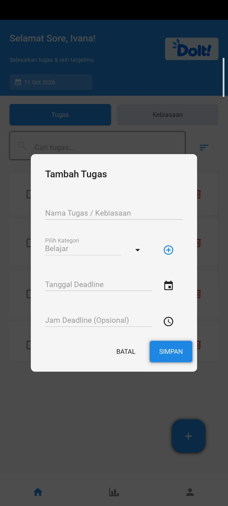
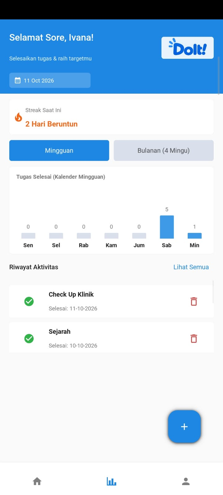
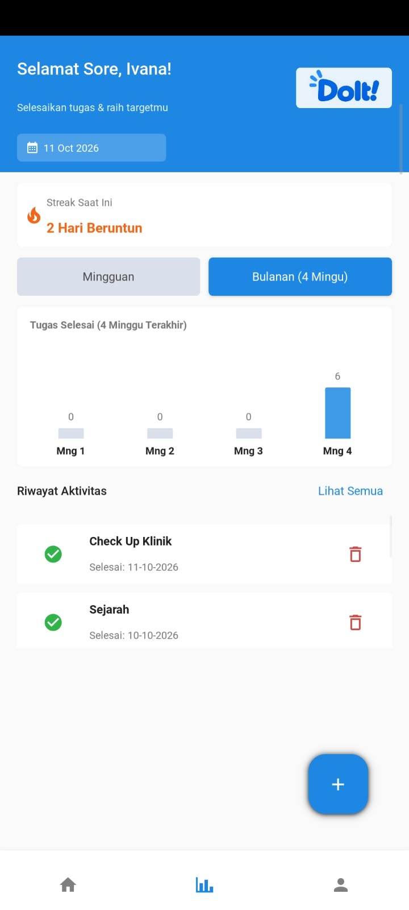
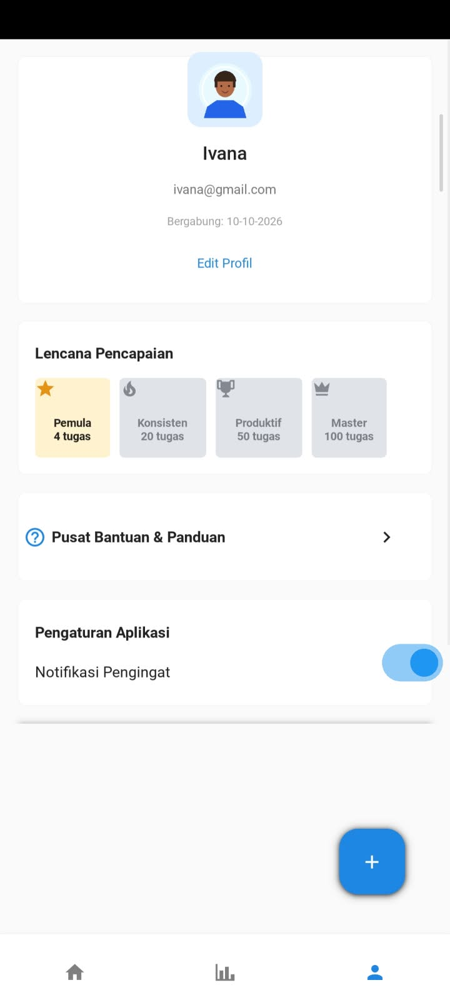
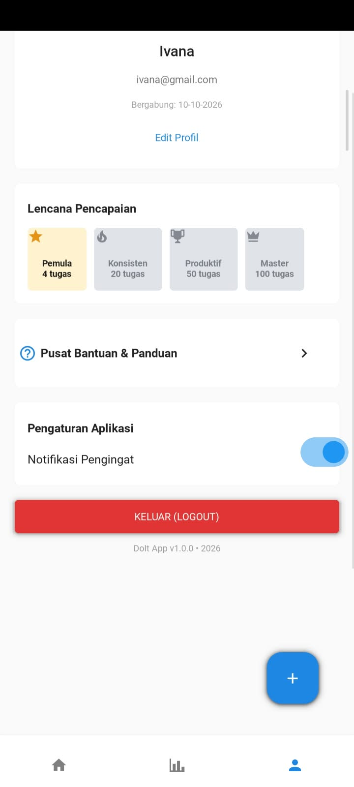
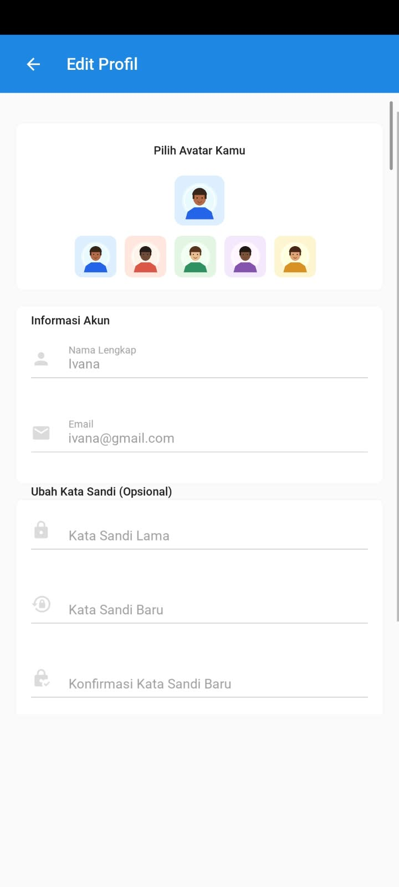

# DoIt! — Aplikasi Todo List & Habit Tracker

DoIt! adalah aplikasi Android yang dirancang untuk membantu pengguna mengelola tugas, mengatur deadline, membangun kebiasaan positif, dan memantau perkembangan aktivitas sehari-hari.

Aplikasi ini dikembangkan menggunakan Python, Kivy/KivyMD, SQLite, serta komponen Java untuk mendukung integrasi dengan sistem Android.

## 📌 Tentang Aplikasi

DoIt! bertujuan membantu pengguna menjadi lebih terorganisir dan produktif melalui pengelolaan tugas dan kebiasaan dalam satu aplikasi.

### Tujuan Aplikasi

- Memudahkan pengguna mencatat dan mengelola tugas.
- Membantu pengguna menentukan tanggal dan waktu deadline.
- Membantu pengguna membangun kebiasaan positif.
- Menyediakan riwayat penyelesaian tugas.
- Menampilkan statistik dan streak aktivitas.
- Memberikan pengingat deadline melalui notifikasi Android.

## ✨ Fitur Aplikasi

1. **Registrasi dan Login** — Membuat akun dan masuk ke aplikasi.
2. **Beranda** — Mengakses daftar tugas dan kebiasaan.
3. **Tambah Tugas/Kebiasaan** — Menambahkan aktivitas baru.
4. **Pengaturan Deadline** — Menentukan tanggal dan waktu tugas.
5. **Edit dan Hapus Tugas** — Mengubah atau menghapus aktivitas.
6. **Penyelesaian Tugas** — Menandai aktivitas yang telah selesai.
7. **Statistik Mingguan** — Melihat informasi penyelesaian tugas mingguan.
8. **Statistik Bulanan** — Melihat ringkasan statistik berdasarkan periode yang disediakan aplikasi.
9. **Streak dan Riwayat** — Memantau konsistensi dan melihat tugas yang selesai.
10. **Profil Pengguna** — Melihat dan mengubah informasi profil.
11. **Notifikasi Deadline** — Memberikan pengingat tugas sesuai konfigurasi aplikasi.
12. **Pencapaian** — Melihat pencapaian berdasarkan jumlah tugas selesai.
13. **Pusat Bantuan** — Membaca panduan penggunaan aplikasi.
14. **Logout** — Keluar dari sesi akun.

## 📸 Tampilan Aplikasi

Berikut adalah tujuh screenshot antarmuka aplikasi DoIt!.

### 1. Beranda



Halaman beranda merupakan halaman utama untuk melihat daftar tugas dan kebiasaan serta mengakses menu yang tersedia.

### 2. Tambah Tugas/Kebiasaan



Halaman ini digunakan untuk menambahkan tugas atau kebiasaan baru. Pengguna dapat mengisi informasi aktivitas, memilih kategori, dan menentukan deadline jika tersedia.

### 3. Statistik Mingguan



Halaman ini menampilkan ringkasan penyelesaian tugas mingguan untuk membantu pengguna mengevaluasi aktivitas dan produktivitasnya.

### 4. Statistik Bulanan



Halaman ini menampilkan ringkasan statistik berdasarkan periode yang disediakan aplikasi sehingga pengguna dapat melihat perkembangan penyelesaian tugas.

### 5. Halaman Profil



Halaman profil menampilkan informasi pengguna dan menyediakan akses ke fitur pengelolaan akun serta pengaturan aplikasi.

### 6. Konfirmasi Logout



Halaman atau dialog logout digunakan untuk mengonfirmasi tindakan keluar dari akun sebelum aplikasi kembali ke halaman login.

### 7. Edit Profil



Halaman edit profil digunakan untuk mengubah informasi akun yang didukung aplikasi, seperti nama pengguna atau foto profil.

## 📖 Manual Book (Panduan Pengguna)

### 1. Persiapan

Pastikan aplikasi DoIt! telah dipasang pada perangkat Android yang kompatibel. Jika aplikasi tersedia dalam bentuk APK, gunakan file APK yang diberikan oleh pengembang.

### 2. Registrasi Akun

1. Buka aplikasi DoIt!.
2. Pilih menu registrasi jika belum memiliki akun.
3. Isi informasi yang diminta, seperti nama, alamat email, dan kata sandi.
4. Tekan tombol registrasi.
5. Setelah berhasil, masuk menggunakan akun yang telah dibuat.

**Catatan:** Ikuti format email dan ketentuan kata sandi yang diterapkan aplikasi.

### 3. Login

1. Buka aplikasi DoIt!.
2. Masukkan alamat email dan kata sandi yang telah didaftarkan.
3. Tekan tombol Login.
4. Jika data sesuai, aplikasi akan membuka halaman utama.

Jika login gagal, periksa kembali informasi akun yang dimasukkan.

### 4. Menggunakan Beranda

1. Buka halaman utama setelah berhasil login.
2. Lihat daftar tugas dan kebiasaan.
3. Pilih menu atau tab yang sesuai untuk mengakses aktivitas.
4. Gunakan menu navigasi untuk membuka statistik, riwayat, atau profil.

### 5. Menambahkan Tugas atau Kebiasaan

1. Tekan tombol tambah aktivitas.
2. Masukkan nama tugas atau kebiasaan.
3. Pilih kategori yang sesuai.
4. Tentukan tanggal dan waktu deadline jika diperlukan.
5. Simpan aktivitas.
6. Pastikan aktivitas muncul pada daftar yang sesuai.

### 6. Mengedit atau Menghapus Tugas

1. Cari aktivitas yang ingin diubah atau dihapus.
2. Pilih tindakan edit atau hapus.
3. Jika mengedit, ubah informasi yang diperlukan lalu simpan.
4. Jika menghapus, pastikan aktivitas yang dipilih benar sebelum mengonfirmasi.

### 7. Menyelesaikan Tugas

1. Cari aktivitas yang telah selesai dikerjakan.
2. Tekan tombol atau kotak centang penyelesaian.
3. Aplikasi akan memperbarui status tugas.
4. Periksa riwayat atau statistik untuk melihat pembaruan yang tersedia.

### 8. Menggunakan Notifikasi Deadline

1. Pastikan izin notifikasi diberikan jika diminta oleh Android.
2. Buat tugas dan tentukan deadline.
3. Pastikan pengingat dijadwalkan oleh aplikasi.
4. Periksa notifikasi yang muncul pada perangkat.

Notifikasi bergantung pada izin, pengaturan perangkat, dan konfigurasi penjadwalan aplikasi.

### 9. Melihat Statistik Mingguan dan Bulanan

1. Buka menu statistik.
2. Pilih periode mingguan atau bulanan jika tersedia.
3. Perhatikan ringkasan penyelesaian tugas.
4. Gunakan informasi tersebut untuk mengevaluasi aktivitas.

### 10. Melihat Streak dan Riwayat

1. Buka bagian statistik atau riwayat.
2. Periksa informasi streak yang ditampilkan.
3. Lihat daftar aktivitas yang telah selesai.
4. Perhatikan nama tugas dan tanggal penyelesaiannya.

### 11. Mengelola Profil

1. Buka menu Profil.
2. Periksa informasi akun.
3. Pilih opsi edit profil.
4. Ubah informasi yang diperlukan.
5. Simpan perubahan.

### 12. Logout

1. Tekan tombol Logout.
2. Periksa dialog konfirmasi.
3. Konfirmasikan jika ingin keluar dari akun.
4. Aplikasi akan kembali ke halaman login.

## 🛠️ Teknologi yang Digunakan

| Teknologi | Fungsi |
|---|---|
| Python | Logika utama aplikasi |
| Kivy | Pengembangan antarmuka aplikasi |
| KivyMD | Komponen antarmuka bergaya Material Design |
| SQLite | Penyimpanan data lokal |
| Java Android | Mendukung integrasi dengan sistem Android |
| Visual Studio Code | Lingkungan pengembangan kode |

## 📂 Struktur Proyek

```text
DoItApp/
├── main.py
├── database.py
├── doit.kv
├── android_src/
│   └── org/
│       └── ...
├── screenshots/
│   ├── beranda.png
│   ├── tambah-tugas.png
│   ├── statistik-mingguan.png
│   ├── statistik-bulanan.png
│   ├── profil.png
│   ├── logout.png
│   └── edit-profil.png
└── README.md
```

**Keterangan:**

- `main.py` — Menangani logika utama, alur halaman, dan interaksi pengguna.
- `database.py` — Mengelola operasi penyimpanan dan pengambilan data.
- `doit.kv` — Mendefinisikan tata letak antarmuka Kivy.
- `android_src/` — Berisi kode Java untuk komponen Android yang digunakan proyek.
- `screenshots/` — Menyimpan gambar tampilan aplikasi untuk dokumentasi.
- `README.md` — Berisi deskripsi proyek dan panduan penggunaan.

Struktur di atas merupakan contoh ringkas. Sesuaikan dengan struktur proyek yang sebenarnya.

## ▶️ Menjalankan Proyek

Untuk menjalankan kode sumber, siapkan Python dan seluruh dependensi yang diperlukan.

Jika lingkungan pengembangan telah siap, aplikasi dapat dijalankan melalui terminal menggunakan:

```bash
python main.py
```

Perintah tersebut digunakan untuk menjalankan proyek dalam lingkungan Python yang sesuai. Pembuatan APK Android membutuhkan konfigurasi build dan dependensi Android tambahan.

## ⚠️ Pemecahan Masalah

**Tidak bisa login**
- Periksa kembali email dan kata sandi.
- Pastikan akun telah terdaftar.

**Notifikasi tidak muncul**
- Periksa izin notifikasi Android.
- Periksa deadline dan penjadwalan pengingat.
- Periksa pengaturan baterai atau pembatasan aplikasi di perangkat.

**Tugas tidak muncul**
- Periksa tab tugas atau kebiasaan.
- Pastikan aktivitas belum selesai atau terhapus.
- Buka kembali halaman daftar aktivitas.

**Screenshot tidak tampil di README**
- Pastikan gambar berada di folder `screenshots`.
- Periksa kembali nama file dan ekstensi gambar.
- Pastikan jalur gambar di README sesuai dengan lokasi file.
- Buka tab Preview untuk memeriksa tampilan Markdown.

## 👨‍💻 Informasi Pengembang

- **Nama Aplikasi:** DoIt!
- **Jenis Aplikasi:** Todo List & Habit Tracker
- **Platform:** Android
- **Bahasa Pemrograman:** Python dan Java untuk komponen Android
- **Framework:** Kivy/KivyMD
- **Database:** SQLite
- **Nama Pengembang:** [Nama Kamu]
- **Sekolah:** [Nama Sekolah]
- **Program Keahlian:** [Program Keahlian]
- **Tahun Pembuatan:** [Tahun]

## 📄 Lisensi

Proyek ini dikembangkan untuk keperluan pembelajaran dan proyek akhir sekolah. Ketentuan penggunaan atau distribusi lebih lanjut mengikuti keputusan pengembang.

---

**DoIt! — Atur tugasmu, bangun kebiasaan baik, dan selesaikan aktivitasmu tepat waktu.**
